<!--
  Cards are static SVGs in cards/, generated by cards/generate.sh against a local
  github-stats-extended server running with my own GitHub token, so they include
  private repos and contributions. To refresh: start the server (steps at the top
  of the script), run ./cards/generate.sh, commit the SVGs.
  2022 to now covers repos I own and repos in orgs I own that I've committed to.
  2014 to 2021 uses the card's defaults: repos I own, no languages hidden.
  Repos are grouped by last push date.
-->

I write cryptography primitives, ZK circuits and the privacy infrastructure. Most of my time goes into pairings, recursion, post-quantum schemes and my private payments startup MIST.cash.

## Highlights

- Paper on pairing proofs accepted at IACR TCHES 2027.
- Largest external contributor to [gnark](https://github.com/Consensys/gnark).
- Created [Starklings](https://github.com/shramee/starklings), an interactive tutorial for Cairo and Starknet. 470+ stars.

## Research

| Repo | What it is |
| --- | --- |
| [mistcash/polyring](https://github.com/mistcash/polyring) | Groth16-in-Groth16 recursion for gnark. Maintained code for my TCHES 2027 paper. |
| [shramee/cairo_pairing](https://github.com/shramee/cairo_pairing) | Elliptic curve pairings in Cairo, with a residue witness for the final exponentiation. |
| [mistcash/pq](https://github.com/mistcash/pq) | Post-quantum messaging for private payments and peer coordination. |
| [mistcash/groth16-wasm-webgpu](https://github.com/mistcash/groth16-wasm-webgpu) | Browser benchmark of arkworks, gnark and snarkjs on a 53k-constraint circuit in WASM andWebGPU. |
| [shramee/noir-elgamal](https://github.com/shramee/noir-elgamal) | Additively homomorphic ElGamal on elliptic curves, in Noir. |

## Open source contributions

| Project | Merged work |
| --- | --- |
| **gnark** | [Pairing check optimisation](https://github.com/Consensys-Incorporated/gnark/pull/1335), [final exponentiation select optimisation](https://github.com/Consensys-Incorporated/gnark/pull/1328), [no division in the Miller loop result](https://github.com/Consensys-Incorporated/gnark/pull/1363), [faster ECDSA on all curves](https://github.com/Consensys-Incorporated/gnark/pull/1384), faster sparse Fp6 multiplication ([#1076](https://github.com/Consensys-Incorporated/gnark/pull/1076), [#1077](https://github.com/Consensys-Incorporated/gnark/pull/1077)), [multi-pairing assertion reusing a GT element](https://github.com/Consensys-Incorporated/gnark/pull/1808), bug fixes ([#1753](https://github.com/Consensys-Incorporated/gnark/pull/1753), [#1814](https://github.com/Consensys-Incorporated/gnark/pull/1814)) |
| **Aztec** | [More ZK flavors in barretenberg WASM](https://github.com/AztecProtocol/aztec-packages/pull/14072) |
| **Garaga** | [Residue witness](https://github.com/keep-starknet-strange/garaga/pull/122), [Honk verification errors](https://github.com/keep-starknet-strange/garaga/pull/391), [gnark Groth16 proof parsing](https://github.com/keep-starknet-strange/garaga/pull/486). The idea behind [extension field batching per Miller loop bit](https://github.com/keep-starknet-strange/garaga/pull/129), which its author says makes Miller loops almost 2x cheaper and keeps witness size constant regardless of the number of pairs. |
| **arkworks** | [Stark curve and large 2-adicity field tests](https://github.com/arkworks-rs/algebra/pull/1001) |
| **Cairo** | [u384 serde in 2 felts](https://github.com/starkware-libs/cairo/pull/6789) |
| **Alexandria** | [ed25519 optimisations](https://github.com/keep-starknet-strange/alexandria/pull/306), [sha512 optimisation](https://github.com/keep-starknet-strange/alexandria/pull/308), [u512 arithmetic](https://github.com/keep-starknet-strange/alexandria/pull/303) |
| **Dojo** | [Writer contracts](https://github.com/dojoengine/dojo/pull/912), [schema macro](https://github.com/dojoengine/dojo/pull/920), [enum introspection](https://github.com/dojoengine/dojo/pull/1019), [model read/write access](https://github.com/dojoengine/dojo/pull/1102), [bytes31 introspection](https://github.com/dojoengine/dojo/pull/2661) |

Older Starknet tools: [Hanji](https://github.com/shramee/hanji) generates docs for Cairo libraries. [shhtarknet](https://github.com/shramee/shhtarknet) keeps secrets for Starknet contracts. [wasm-blockifier](https://github.com/shramee/wasm-blockifier) runs the Starknet blockifier in WASM.
